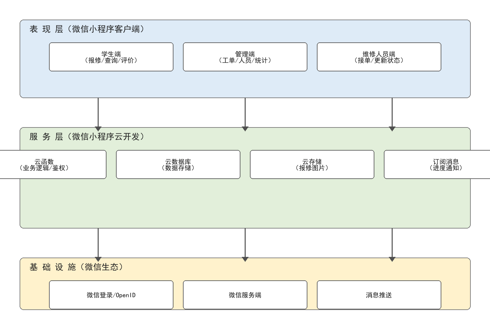
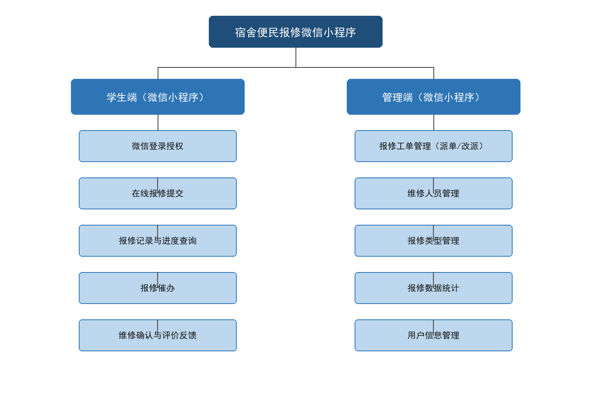
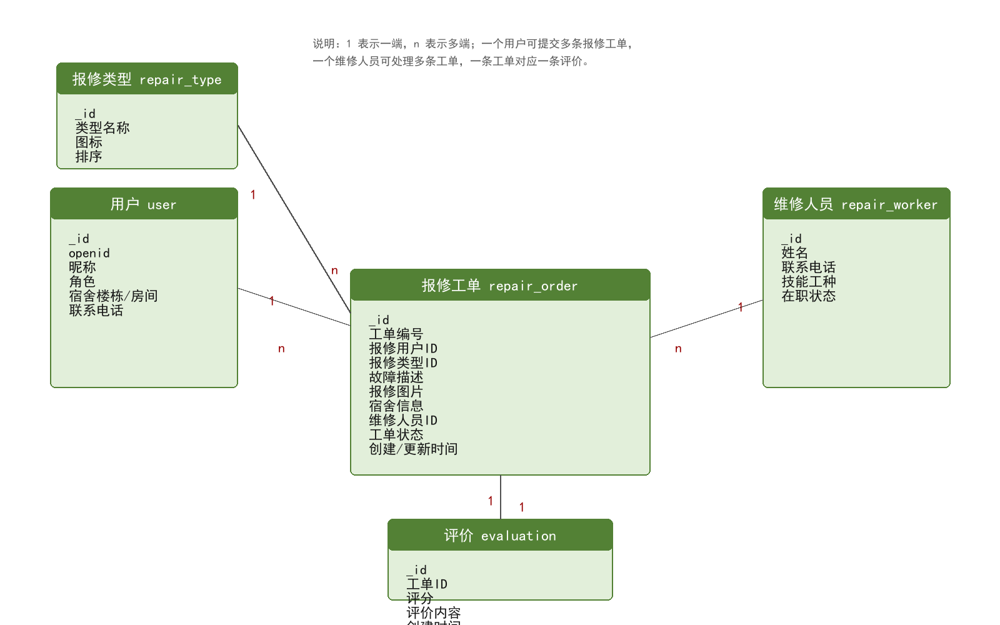
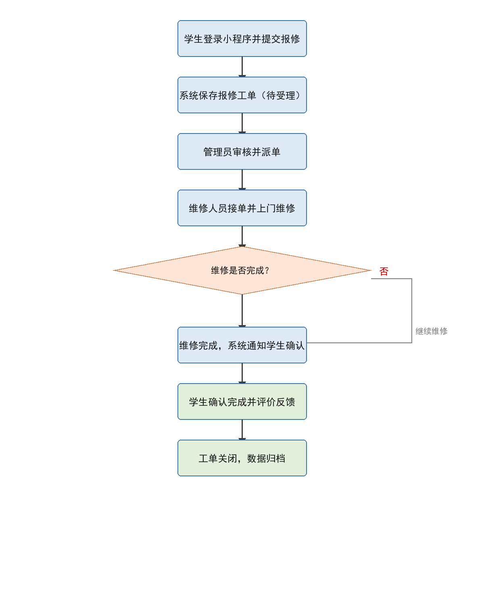

[README.md](https://github.com/user-attachments/files/34123632/README.md)
# legendary-winner# 宿舍便民报修微信小程序的设计与实现

> 基于 **微信小程序 · 云开发** 的校园宿舍报修系统：学生在线报修 → 管理员审核派单 → 维修人员上门处理 → 学生确认评价，全流程线上闭环。
> 本仓库同时收录该毕业设计论文的正文、技术插图与一键排版工具链。


---

## 一、项目简介

高校宿舍的水电、门窗、家具、网络等设施故障报修需求频繁，而传统"值班室填纸质单 / 打电话找宿管"的方式存在 **流程繁琐、信息传递慢、进度不可查、数据难统计** 四大痛点。

本项目设计并实现了一个面向学生、维修人员、后勤管理员三类角色的宿舍报修小程序：

- **免安装、即用即走**：依托微信生态，扫码或搜索即可使用，无需下载 App；
- **免服务器运维**：后端完全基于微信小程序云开发（云函数 + 云数据库 + 云存储 + 订阅消息），无需购买和搭建服务器；
- **报修闭环**：从提交、审核、派单、维修、确认到评价归档，每个环节状态可追踪；
- **数据沉淀**：工单按类型、状态聚合统计，为后勤管理提供决策依据。

## 二、功能特性

### 学生端

| 功能 | 说明 |
| --- | --- |
| 微信登录授权 | 通过 `wx.login` + 云函数获取 `openid`，首次使用自动创建用户记录 |
| 在线报修 | 选择报修类型（水电 / 家具 / 网络 / 门窗等）、填写故障描述、选择楼栋房间、上传现场图片 |
| 报修记录与进度查询 | 列表展示历史工单及当前状态，实时了解维修进度 |
| 报修催办 | 对长时间未处理的工单发起催办，通知管理员 |
| 维修确认与评价 | 维修完成后确认完成，对服务质量评分并填写评价 |

### 维修人员端

| 功能 | 说明 |
| --- | --- |
| 工单查看 | 查看被指派的工单，含故障详情、报修位置与现场图片 |
| 接单与状态更新 | 接单后上门维修，过程中更新工单状态 |
| 维修结果登记 | 填写维修结果与完成说明 |

### 管理端

| 功能 | 说明 |
| --- | --- |
| 工单管理 | 审核、派单、改派、关闭，按状态筛选，实现流程闭环管控 |
| 维修人员管理 | 维护姓名、联系电话、技能工种、在职状态 |
| 报修类型管理 | 维护故障分类及排序、图标 |
| 数据统计 | 按报修类型与工单状态聚合统计并以图表展示 |
| 用户信息管理 | 查看与管理用户角色、宿舍信息 |

## 三、技术栈

| 层次 | 技术选型 |
| --- | --- |
| 客户端 | 微信小程序（WXML / WXSS / JavaScript ES6），微信开发者工具 |
| 后端服务 | 微信小程序云开发 · 云函数（Node.js + `wx-server-sdk`） |
| 数据存储 | 云开发文档型数据库（集合 / 文档 / JSON） |
| 文件存储 | 云存储（报修现场图片，返回 `fileID`） |
| 消息通知 | 订阅消息（工单进度推送） |
| 身份鉴权 | 微信登录 + `openid` 唯一标识 + 角色字段控制权限 |
| 文档工程 | Python 3 + `python-docx` + `lxml` + `Pillow`（论文与插图自动生成） |

## 四、系统架构

系统采用三层架构，表现层负责交互，服务层由云开发承载业务，基础设施层依托微信生态：

```
┌──────────────────────────────────────────────────────────────┐
│ 表现层（微信小程序客户端）                                     │
│   学生端（报修 / 查询 / 评价）  管理端（工单 / 人员 / 统计）    │
│   维修人员端（接单 / 更新状态）                                │
└───────────────────────────┬──────────────────────────────────┘
                            │ wx.cloud.callFunction / SDK
┌───────────────────────────▼──────────────────────────────────┐
│ 服务层（微信小程序云开发）                                     │
│   云函数（业务逻辑 / 鉴权）  云数据库（数据存储）               │
│   云存储（报修图片）          订阅消息（进度通知）              │
└───────────────────────────┬──────────────────────────────────┘
                            │
┌───────────────────────────▼──────────────────────────────────┐
│ 基础设施（微信生态）                                           │
│   微信登录 / OpenID · 微信服务端 · 消息推送                    │
└──────────────────────────────────────────────────────────────┘
```



数据流向：小程序端发起请求 → 云函数校验身份与参数 → 写入云数据库 / 上传图片至云存储 → 工单状态变化时通过订阅消息推送进度 → 客户端查询展示。

功能模块划分见下图：



## 五、数据库设计

共设计 5 个集合，围绕"报修工单"组织数据：

| 集合 | 主要字段 | 说明 |
| --- | --- | --- |
| `user` | `_id`、`openid`、昵称、角色、宿舍楼栋、房间号、联系电话 | 用户基本信息与角色 |
| `repair_type` | `_id`、类型名称、图标、排序 | 报修故障分类 |
| `repair_order` | `_id`、工单编号、报修用户、报修类型、故障描述、报修图片、宿舍信息、维修人员、工单状态、创建/更新时间 | 报修业务数据 |
| `repair_worker` | `_id`、姓名、联系电话、技能工种、在职状态 | 维修人员信息 |
| `evaluation` | `_id`、工单 ID、评分、评价内容、创建时间 | 用户评价数据 |

关系：用户 1—N 工单，报修类型 1—N 工单，维修人员 1—N 工单，工单 1—1 评价。



### 工单状态流转

```
待受理 ──审核派单──> 已派单 ──接单──> 维修中 ──完工──> 待确认 ──确认完成──> 已完成
   │                    │                                      │
   └────────────── 关闭 / 取消 ────────────────────────────> 已关闭
```



## 六、核心云函数

| 云函数 | 职责 | 关键操作 |
| --- | --- | --- |
| `login` | 微信登录与用户初始化 | 取 `OPENID`，查询 `user` 集合，不存在则创建（默认 `role: student`） |
| `submitRepair` | 提交报修 | 生成工单号 `BX + 时间戳`，写入 `repair_order`，初始状态 `pending` |
| `assignOrder` | 管理员派单 | 更新 `workerId`、状态 `assigned` 与派单时间 |
| 状态更新 / 统计类 | 维修状态流转、进度通知、按类型与状态聚合统计 | 更新 `repair_order`、推送订阅消息、聚合查询 |

登录云函数示例：

```js
// cloudfunctions/login/index.js
const cloud = require('wx-server-sdk')
cloud.init({ env: cloud.DYNAMIC_CURRENT_ENV })
const db = cloud.database()

exports.main = async () => {
  const { OPENID } = cloud.getWXContext()
  const users = db.collection('user')
  const res = await users.where({ openid: OPENID }).get()
  if (res.data.length === 0) {
    await users.add({ data: { openid: OPENID, role: 'student', createTime: db.serverDate() } })
  }
  return { openid: OPENID }
}
```

## 七、快速开始

### A. 运行小程序

1. 安装并登录 **微信开发者工具**（稳定版）；
2. 导入小程序工程目录，在 `project.config.json` 中填入自己的 `appid`；
3. 在工具顶部开通 **云开发**，创建环境（免费额度即可）；
4. 在云开发控制台创建集合 `user`、`repair_type`、`repair_order`、`repair_worker`、`evaluation`，并按查询条件建立索引；
5. 右键各云函数目录选择 **上传并部署：云端安装依赖**；
6. 编译预览：模拟器或手机微信真机测试报修全流程。

> 当前仓库收录的是论文与排版工程；小程序端页面与云函数源码在微信开发者工具工程中维护，未纳入本仓库。

### B. 重新生成论文（Word / PDF）

论文由脚本从学校模板自动填充生成，**无需手工排版**：

```bash
# 1. 安装依赖
pip install python-docx lxml Pillow pdfplumber pypdfium2

# 2. 生成 4 张技术插图（架构图 / 模块图 / 流程图 / E-R 图）
python work/make_figs.py

# 3. 以学校模板为底稿，生成完整论文 docx
python work/build_doc.py
```

`work/build_doc.py` 会完成：封面题目、一二三级标题样式、真实 TOC 域、摘要与关键词、7 章正文、2 张表格、10 篇参考文献（GB/T 7714-2015）、评阅表填写、页脚 PAGE 域与分节页码。

> 脚本中的 `SRC` / `TGT` / `FIG` 为作者本机绝对路径，复现前请先改为你本地的模板路径与输出路径。
> 生成后用 Word 打开并按 `Ctrl+A → F9` 更新目录；导出 PDF 可用 Word「另存为 PDF」或 `soffice --headless --convert-to pdf`。

生成结果可在 [`work/render/宿舍便民报修微信小程序的设计与实现.pdf`](work/render/宿舍便民报修微信小程序的设计与实现.pdf) 查看。

## 八、仓库结构

```
.
├── work/                              # 论文工程主目录
│   ├── build_doc.py                   # ★ 以模板为底稿生成完整论文 docx（正文/表格/参考文献/评阅表）
│   ├── make_figs.py                   # ★ Pillow 绘制架构图、模块图、流程图、E-R 图
│   ├── figs/                          # 生成的技术插图（fig1~fig4）
│   ├── media/                         # 从模板 docx 提取的媒体资源
│   ├── outline.md                     # 论文大纲、图表规划、参考文献清单
│   ├── template-plan.md               # 模板填写计划：区域 / 定位 / 编辑方式 / 验收条件
│   ├── attachment_purpose.md          # 模板附件用途与格式要求汇总
│   ├── render/                        # 最终 PDF 成品
│   ├── read_template.py               # 模板结构读取（段落/表格/分节/页眉页脚）
│   ├── analyze_template.py            # 模板样式与图片分析
│   ├── raw_xml.py / check_parts.py    # 底层 XML 与节结构检查
│   ├── extract_media.py               # 模板媒体提取
│   └── map_images.py                  # 图片与段落位置映射
├── analyze_*.py                       # 文档结构探查脚本（正文/表格/页脚/目录/SDT 等）
├── check_*.py                         # 质量校验（格式、页码、目录、引用、分节）
├── render_*.py / extract_pages.py     # PDF 渲染成图、章节页码提取
├── verify_final.py                    # ★ 成品回读验证：封面/评阅表/目录/图表/参考文献/残留检查
└── README.md
```

这些脚本构成了一个可复用的 **"模板 → 内容 → 校验 → PDF"** 文档流水线：先用 `analyze_*` 摸清模板结构，再由 `build_doc.py` 精准填充，最后用 `check_*` / `verify_final.py` 回读验收。

## 九、论文结构

| 章节 | 内容 |
| --- | --- |
| 摘要 / 关键词 | 研究目的、方案（小程序云开发）、主要功能、测试结论；关键词 5 个 |
| 1 绪论 | 课题背景与意义、国内外研究现状、研究内容与论文结构 |
| 2 相关技术介绍 | 微信小程序技术、云开发技术（云函数 / 云数据库 / 云存储）、其他相关技术 |
| 3 系统需求分析 | 可行性分析、功能需求（三类角色）、非功能需求 |
| 4 系统设计 | 总体架构、功能模块、数据库设计（含 4 图 1 表） |
| 5 系统实现 | 开发环境、学生端实现、管理端实现（含云函数核心代码） |
| 6 系统测试 | 测试环境与方法、9 条功能测试用例、测试结论 |
| 7 总结与展望 | 工作总结、不足与展望 |
| 参考文献 | 10 篇，中文在前，GB/T 7714-2015 格式 |

## 十、系统测试

采用黑盒测试，在微信开发者工具模拟器与 Android 真机上执行，9 条核心用例全部通过：

| 编号 | 测试内容 | 预期结果 | 实际 |
| --- | --- | --- | --- |
| TC-01 | 学生微信授权登录 | 获取 openid 并创建用户记录 | 通过 |
| TC-02 | 提交报修（含图片） | 工单创建成功，图片正常上传 | 通过 |
| TC-03 | 报修必填项校验 | 缺项时提示且无法提交 | 通过 |
| TC-04 | 查看报修记录与进度 | 正确显示记录与状态 | 通过 |
| TC-05 | 报修催办 | 产生催办记录并通知管理员 | 通过 |
| TC-06 | 管理员审核并派单 | 状态变为已派单并记录维修人员 | 通过 |
| TC-07 | 维修人员更新状态 | 状态按流程正确流转 | 通过 |
| TC-08 | 学生确认完成并评价 | 评价入库，状态变为已完成 | 通过 |
| TC-09 | 报修数据统计 | 按类型和状态统计正确 | 通过 |

## 十一、已知不足与后续计划

- [ ] 未对接学校统一身份认证，身份识别依赖微信授权，实名性不足；
- [ ] 数据统计较为基础，缺少维修需求预测与资源智能调度；
- [ ] 报修图片未做内容审核，存在违规上传风险；
- [ ] 界面交互与评价维度仍有优化空间（多维度评分、图片补充评价等）。

后续计划：接入学校统一认证与权限体系 → 引入数据分析 / 机器学习做工单预测 → 增加图片内容安全审核 → 持续打磨交互体验。

## 十二、说明

- 项目作者：杨锋 · 江西软件职业技术大学 电子信息学院 软件技术 C240313 班
- 本仓库内容用于毕业设计《宿舍便民报修微信小程序的设计与实现》的撰写、排版与交付，论文与图表均由脚本生成，便于复现与二次修改。
- 欢迎 Issue 交流；若本项目对你有帮助，欢迎 Star ⭐
